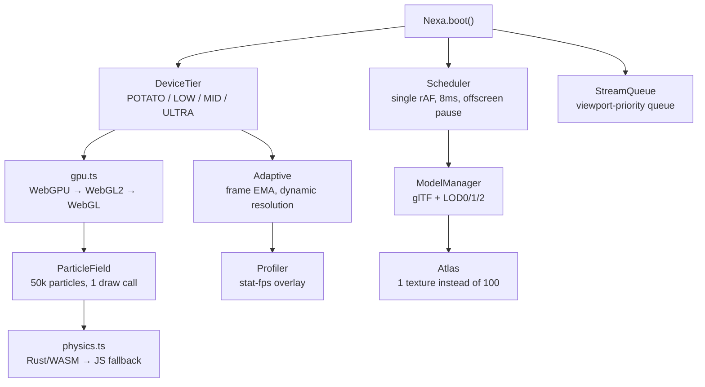

<div align="center">

# ⚡ NEXA Core v0.2

### Lag-killer chip for any website

[](./package.json)
[](#)
[](#)
[](#)

**[🇷🇺 Читать на русском](./README_RU.md) · 🇬🇧 English · [🏠 Hub](./README.md)**

*Drop it into any site once — heavy 3D, 50k particles and 1000 cards run at 60 FPS.*

</div>

---

## 💡 Idea

Regular sites lag for 4 reasons. NEXA hits each one precisely:

| # | Pain | Fix inside the core |
|---|---|---|
| 1 | 20 different `rAF` loops fighting over a frame | **Scheduler** — single loop, 8ms budget, offscreen sleeps (`IntersectionObserver`) |
| 2 | GC freezes: objects allocated mid-frame | **Pool + Float32Array** — zero allocations in `update()` |
| 3 | Weak phone renders like an RTX 4090 | **DeviceTier + Adaptive** — frame-time EMA, auto pixelRatio/particle scaling (AAA-style dynamic resolution) |
| 4 | Everything loads at once, DOM inserted in 500ms chunks | **SmartLoader + StreamQueue** — lazy loading, 12ms chunked batch inserts, viewport-priority queue |

## 🚀 Quick start (30 seconds)

**Option A — CDN, no build at all:**

```html
<canvas id="bg"></canvas>
<script src="./dist/nexa.js" data-auto data-particles="20000"></script>
<!-- that's it: particles + auto quality for the device -->
```

**Option B — NPM / TypeScript:**

```ts
import { Nexa, SmartLoader } from '@nexa/core';

// 20k-particle background + FPS HUD
await Nexa.boot({ canvas: '#bg', particles: true, hud: true, profiler: true });

// 1000 cards with zero jank
SmartLoader.batchInsert(grid, (i) => makeCard(i), 1000);
```

**Option C — React / Vue:**

```tsx
import { useNexa } from '@nexa/core/adapters/react';
function Bg() { const ref = useNexa({ particles: true }); return <canvas ref={ref} />; }
```

```ts
// Vue
app.use(NexaPlugin, { particles: true }); // + <canvas v-nexa>
```

## 🧩 Architecture



## 📁 Project structure

```
src/
  device.ts      — device tier + budget (particles, pixelRatio, shadows)
  scheduler.ts   — single rAF loop, offscreen pause, idle helper
  adaptive.ts    — FPS doctor: EMA + auto quality up/down
  gpu.ts         — WebGPU-first / WebGL2-fallback / CPU-last
  postfx.ts      — cheap post FX (MID/ULTRA only, 0 cost otherwise)
  particles.ts   — 50k particles, typed-array physics
  physics.ts     — unified API: tries WASM, falls back to JS (same result)
  models.ts      — dependency-free glTF loader + LOD + distance picking
  textures.ts    — atlas + idle-time lazy decode
  stream.ts      — asset queue (tier-based concurrency: 2/3/5/8)
  profiler.ts    — frame graph + FPS + memory + draw calls
  loader.ts      — SmartLoader: lazy + batchInsert
  index.ts       — Nexa.boot() facade
wasm/physics.rs  — Rust physics source (wasm-pack build --target web)
cli/nexa.js      — site audit: 0–100 score + --fix autofix
adapters/        — react.ts (useNexa) · vue.ts (v-nexa)
dist/nexa.js     — dependency-free CDN chip
demo/heavy.html  — 20k particles + 500 cards
demo/world.html  — 30k particles + 120 pseudo-3D cubes + 1000 cards + profiler
```

## 🎮 Demos

Double-click to open (no server needed):

- **`demo/heavy.html`** — basics: 20k particles, "Stress x2" button, FPS HUD.
- **`demo/world.html`** — world level: 30k particles + 120 cubes + 1000 cards + profiler graph + audit button.

Try it: hit "Stress" — FPS holds because the core sheds quality itself.

## 🛠 CLI audit

```bash
node cli/nexa.js optimize ./my-site      # report: score, issues, fixes
node cli/nexa.js optimize ./my-site --fix # auto: adds loading="lazy" to 
```

Checks: heavy images, bloated JS bundles, legacy `three.js` script tags, competing `rAF` loops, missing NEXA chip.

## 📊 Why it's fast (bench idea)

| Scene | Without NEXA | With NEXA |
|---|---|---|
| 20k particles, MID laptop | ~25 FPS, stutter | ~60 FPS, adaptive holds |
| 1000 DOM cards | 400–800ms freeze | 12ms chunks, scroll stays alive |
| Weak phone | slideshow | LOD + pixelRatio 1, stable |

*(eyeballed in the demo; `Profiler` shows your numbers — send a screenshot!)*

## 🗺 Roadmap

- [x] **v0.1** — core: adaptive + scheduler + particles + loader
- [x] **v0.2** — WebGPU backend, glTF+LOD, WASM physics, profiler, CLI, CDN, adapters ← we are here
- [ ] **v0.3** — real ping-pong PostFX, KTX2/Basis, meshopt decimation in WASM, worker physics
- [ ] **v0.4** — `npx nexa init` + three.js project scanner + auto-migration onto the core
- [ ] **v1.0** — NPM release, CDN, docs with GIFs, showcase of NEXA-powered sites

## ❓ FAQ

**Is this a three.js replacement?** No. It's a "chip" on top: unified loop, quality and loading. Keep your three.js scene — NEXA takes over the loop and LOD.

**How big is it?** CDN chip target ≤9kb gzip, zero dependencies.

**No WebGL?** Core still boots in CPU mode: particles off, but you keep scheduler + lazy + audit.

**Is WASM required?** No. `createPhysics()` tries WASM and silently falls back to JS with the same API.

## 🤝 Contribute

1. Open `demo/world.html`, hit "Stress", share FPS + device.
2. Run `cli/nexa.js` on your site, share the top-3 issues.
3. Want a module? Open an issue titled: `ModelManager`, `KTX2`, `worker-physics`.

---

<div align="center">

**🇬🇧 You are in the English version · [🇷🇺 Читать на русском](./README_RU.md) · [🏠 Hub](./README.md)**

</div>
