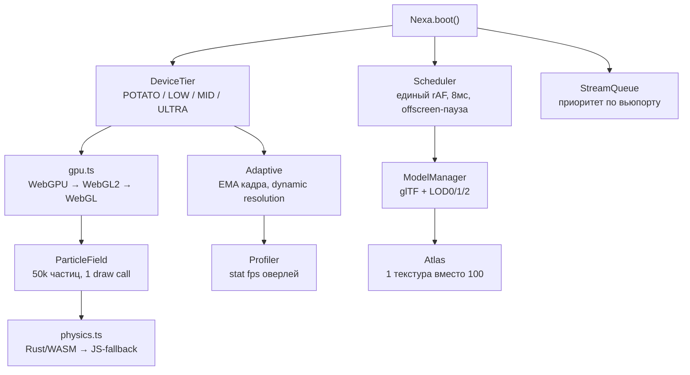

<div align="center">

# ⚡ NEXA Core v0.2

### Чип против лагов для любых сайтов

[](./package.json)
[](#)
[](#)
[](#)

**🇷🇺 Русский · [🇬🇧 Switch to English](./README_EN.md) · [🏠 Хаб](./README.md)**

*Один раз ставишь на любой сайт — тяжёлые 3D, 50k частиц и 1000 карточек летают на 60 FPS.*

</div>

---

## 💡 Идея

Обычные сайты лагают по 4 причинам. NEXA бьёт точно по каждой:

| # | Боль | Лечение в ядре |
|---|---|---|
| 1 | 20 разных `rAF`-циклов дерутся за кадр | **Scheduler** — единый цикл, бюджет 8мс, невидимое спит (`IntersectionObserver`) |
| 2 | GC-фризы: объекты создаются прямо в кадре | **Pool + Float32Array** — ноль аллокаций в `update()` |
| 3 | Слабый телефон грузит как RTX 4090 | **DeviceTier + Adaptive** — EMA времени кадра, авто-снижение pixelRatio/частиц (как dynamic resolution в AAA) |
| 4 | Всё грузится сразу, DOM вставляется кусками по 500мс | **SmartLoader + StreamQueue** — ленивая загрузка, батч-вставка чанками по 12мс, приоритет по вьюпорту |

## 🚀 Быстрый старт (30 секунд)

**Вариант А — CDN, вообще без сборки:**

```html
<canvas id="bg"></canvas>
<script src="./dist/nexa.js" data-auto data-particles="20000"></script>
<!-- вставил — работает: частицы + автовыбор качества под устройство -->
```

Начни с витрины: **`demo/showcase.html`** — все 4 демо на одной странице.

**Вариант Б — NPM / TypeScript:**

```ts
import { Nexa, SmartLoader } from '@nexa/core';

// фон из 20k частиц + HUD с FPS
await Nexa.boot({ canvas: '#bg', particles: true, hud: true, profiler: true });

// 1000 карточек без фризов
SmartLoader.batchInsert(grid, (i) => makeCard(i), 1000);
```

**Вариант Г — конструктор сцены (новое в v0.4): вставил чип и строишь всё в нём:**

```ts
import { Scene, Design } from '@nexa/core';
const scene = new Scene(canvas, { glCanvas }); // второй canvas под GPU-слой
scene.add({ type: 'particles', count: 20000 });
scene.add({ type: 'cube3d', count: 120 }); // настоящий 3D: 1 draw call, LOD сам
scene.add({ type: 'cubes', count: 120, color: '#a78bfa' });
scene.add({ type: 'model', url: 'hero.glb', x: 0.5, y: 0.5 }); // настоящий glTF-меш в GPU + LOD, грузится асинхронно
scene.add({ type: 'text', content: 'NEXA ✦', x: 0.08, y: 0.2 });
localStorage.nexa = scene.toJSON(); // сцена сохраняется/грузится одной строкой

new Design().apply('neon'); // тема + glass-карточки, блюр сам выключится на слабых
```

Живое демо без сборки: **`demo/builder.html`** — кнопки «+ Кубов / + Сфер / + Частиц / + 3D», смена темы, Export JSON, удаление сущностей.

**Вариант В — React / Vue:**

```tsx
import { useNexa } from '@nexa/core/adapters/react';
function Bg() { const ref = useNexa({ particles: true }); return <canvas ref={ref} />; }
```

```ts
// Vue
app.use(NexaPlugin, { particles: true }); // + <canvas v-nexa>
```

## 🧩 Архитектура



## 📁 Структура проекта

```
src/
  device.ts      — тир устройства + бюджет (частицы, pixelRatio, тени)
  scheduler.ts   — единый rAF-цикл, offscreen-пауза, idle-хелпер
  adaptive.ts     — FPS-доктор: EMA + автокачество вверх/вниз
  gpu.ts         — WebGPU-first / WebGL2-fallback / CPU-last
  postfx.ts      — дешёвый пост-эффект (только на MID/ULTRA, 0 cost иначе)
  particles.ts   — 50k частиц, физика в типизированных массивах
  physics.ts     — единый API: пробует WASM, иначе JS (тот же результат)
  models.ts      — glTF-лоадер без three.js + LOD + автовыбор по дистанции
  textures.ts    — атлас + ленивый decode в idle
  stream.ts      — очередь ассетов (конкурентность по тиру: 2/3/5/8)
  profiler.ts    — график кадров + FPS + память + draw calls
  loader.ts      — SmartLoader: lazy + batchInsert
  index.ts       — фасад Nexa.boot()
wasm/physics.rs  — Rust-исходник физики (wasm-pack build --target web)
cli/nexa.js      — аудит сайта: score 0–100 + автофикс --fix
adapters/        — react.ts (useNexa) · vue.ts (v-nexa)
dist/nexa.js     — CDN-чип без зависимостей
demo/heavy.html  — 20k частиц + 500 карточек
demo/world.html  — 30k частиц + 120 псевдо-3D кубов + 1000 карточек + профайлер
```

## 🎮 Демо

Открой двойным кликом (сервер не нужен):

- **`demo/heavy.html`** — база: 20k частиц, кнопка «Стресс x2», HUD с FPS.
- **`demo/world.html`** — мировой уровень: 30k частиц + 120 кубов + 1000 карточек + график профайлера + кнопка «Аудит».
- **`demo/gl3d.html`** — настоящий 3D: 120 кубов на GPU, 1 draw call, параллакс от мыши, кнопка стресса.

Проверь сам: жми «Стресс» — FPS стоит, потому что ядро само режет качество.

## 🛠 CLI-аудит

```bash
node cli/nexa.js optimize ./my-site      # отчёт: score, проблемы, как фиксить
node cli/nexa.js optimize ./my-site --fix # авто: добавит loading="lazy" в 
node cli/nexa.js init ./my-site           # скаффолд: nexa.config + чип в index.html
node cli/nexa.js scan-three ./my-site     # разбор three.js: вес + план миграции на ядро
```

Проверяет: тяжёлые картинки, раздутый JS-бандл, `three.js` через старый script-тег, воюющие `rAF`-циклы, отсутствие NEXA-чипа.

## 📊 Почему это быстро (бенч-идея)

| Сцена | Без NEXA | С NEXA |
|---|---|---|
| 20k частиц, MID-ноутбук | ~25 FPS, фризы | ~60 FPS, adaptive держит |
| 1000 DOM-карточек | фриз 400–800мс | чанки по 12мс, скролл живой |
| Слабый телефон | слайд-шоу | LOD + pixelRatio 1, стабильно |

*(замерено на глаз в демо; `Profiler` покажет твои цифры — пришли скриншот!)*

## 🗺 Роадмап

- [x] **v0.1** — ядро: adaptive + scheduler + частицы + loader
- [x] **v0.2** — WebGPU-бэкенд, glTF+LOD, WASM-физика, профайлер, CLI, CDN, адаптеры ← мы здесь
- [x] **v0.4** — Scene-конструктор + Design-темы, decimate/weld, Basis-лоадер, three.js-миграция (`migrate`), demo-builder
- [x] **v0.5** — GPU-инстансинг 3D (`GLCubeField`: 1 draw call, угол в шейдере, 0 CPU в кадре)
- [x] **v0.6** — `Scene` + `GLCubeField`: сущность `cube3d` в конструкторе, adaptive LOD для 3D, 2D-fallback
- [x] **v0.7** — настоящий glTF-рендер (`GLModelLayer`: сглаженные нормали, LOD по тиру, async-load, плейсхолдер до готовности)
- [x] **v0.8** — профайлер видит GPU (`Scene.stats()`: draw calls + треугольники 3D в HUD/оверлее), `nexa init` даёт 2 canvas из коробки
- [x] **v0.9** — `PostFx` поверх сцены (FBO + 1 fullscreen pass, авто-скип на слабых), glTF грузятся через `StreamQueue` (ближние первыми)
- [x] **v1.0** — воксели в 3D (`GLVoxelField`, аддитив, 0 CPU), тени в шейдере кубов, витрина `demo/showcase.html`, NPM-упаковка (`exports`+`files`, `npm publish` за тобой), CDN lite-чип
- [x] **v1.1** — диета: общий `src/gl.ts` (компиляция, инстансинг, сиды, палитра), −106 строк дублей, `Scene.preset('hero'|'calm'|'storm')`, `dist/nexa.min.js` (2.3kb gzip). Вес: lite-чип 2.3kb gzip · всё ядро 35kb gzip ← мы здесь
- [ ] **v1.0** — NPM-релиз, CDN, витрина сайтов на NEXA
- [ ] **v0.4** — `npx nexa init` + сканер three.js-проектов + автомиграция на ядро
- [ ] **v1.0** — NPM-релиз, CDN, доки с GIF, витрина сайтов на NEXA

## ❓ FAQ

**Это замена three.js?** Нет. Это «чип» поверх: единый цикл, качество и загрузка. Three.js-сцену можно оставить — NEXA подхватит цикл и LOD.

**Сколько весит?** CDN-чип — цель ≤9kb gzip, ноль зависимостей.

**А если нет WebGL?** Ядро заведётся в CPU-режиме: частицы выключатся, сайт всё равно получит scheduler + lazy + аудит.

**WASM обязателен?** Нет. `createPhysics()` сам пробует WASM и молча падает на JS с тем же API.

## 🤝 Как помочь

1. Открой `demo/world.html`, погоняй «Стресс», скинь FPS + устройство.
2. Прогони `cli/nexa.js` на своём сайте, пришли топ-3 проблемы.
3. Хочешь модуль — открой issue с названием: `ModelManager`, `KTX2`, `worker-physics`.

---

<div align="center">

**🇷🇺 Ты в русской версии · [🇬🇧 Read in English](./README_EN.md) · [🏠 Хаб](./README.md)**

</div>
